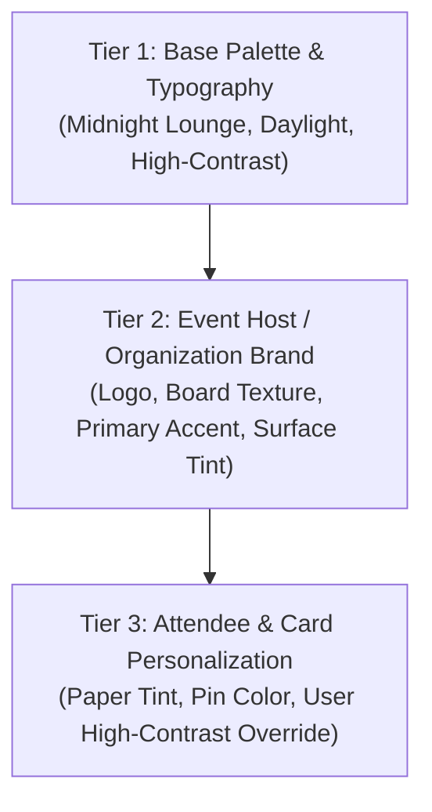
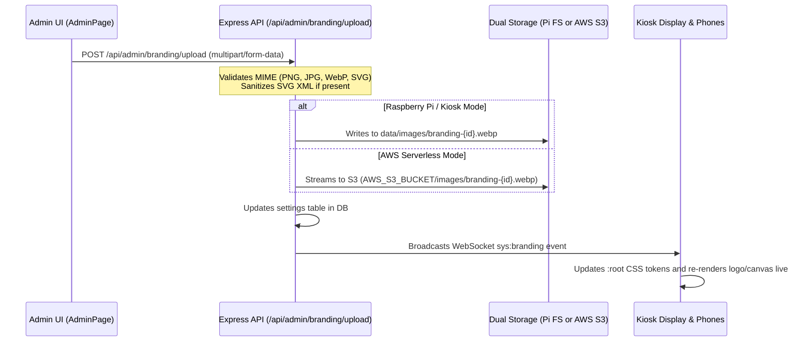

# Design Document 0003: Skinning Architecture, Tactile Card Personalization, & Mobile Companion UX

- **Status:** Proposed
- **Context Date:** October 2026
- **Companion ADR:** [ADR 0011](../../adr/0011-theming-skinning-and-mobile-companion-ux)

## 1. Overview & Objectives

This design document establishes the concrete technical blueprints, component interfaces, mobile interaction models, and dual-target asset storage contracts required to implement **ADR 0011**.

It addresses three primary design goals:

1. **Aesthetic Parity with `wishboards.app`:** Establishing a semantic 3-tier CSS custom property token hierarchy (`--wb-*`) that replaces legacy hardcoded colors while implementing the modern dark glassmorphism ("Midnight Lounge") theme.
2. **Dual-Persona Skinning Contracts:**
   - **Persona A — Event Host Branding:** Runtime system branding (organization logos, brand colors, board background textures/graphics) configured live via `AdminPage` across both disconnected Raspberry Pi kiosks and AWS Serverless deployments.
   - **Persona B — Attendee Personalization:** Tactile per-wish 3×5 index card paper tints and pushpin styling, backed by database-persisted user preferences (`users.ui_preferences`).
3. **Mobile-First Companion Interface ("Controller vs. Canvas"):** Eliminating vertical scroll fatigue on mobile viewports (`375×667` to `390×844`) through progressive-disclosure bottom sheets, a focused 4-tab thumb navigation bar, and a compact single-screen card composer.

---

## 2. Three-Tier Semantic CSS Token Hierarchy

All client stylesheets (`src/client/src/styles.css`), component CSS modules, and inline styles will consume tokens prefixed with `--wb-*`.



### 2.1 Token Specification

| Token                      | Tier   | Default ("Midnight Lounge")  | Purpose                                                      |
| :------------------------- | :----- | :--------------------------- | :----------------------------------------------------------- |
| `--wb-bg-canvas`           | Tier 1 | `#080d1a`                    | Base viewport background color behind cards/kiosk            |
| `--wb-bg-surface`          | Tier 1 | `rgba(30, 41, 59, 0.78)`     | Glassmorphic container & card backdrop                       |
| `--wb-bg-surface-elevated` | Tier 1 | `rgba(51, 65, 85, 0.85)`     | Modal, bottom-sheet, and dropdown backdrop                   |
| `--wb-border-subtle`       | Tier 1 | `rgba(255, 255, 255, 0.12)`  | Glass card and container border highlight                    |
| `--wb-text-primary`        | Tier 1 | `#f8fafc`                    | Primary body and heading text                                |
| `--wb-text-secondary`      | Tier 1 | `#94a3b8`                    | Subtitles, labels, and timestamps                            |
| `--wb-accent-primary`      | Tier 2 | `#f59e0b`                    | Primary call-to-action button and active states (Warm Amber) |
| `--wb-accent-hover`        | Tier 2 | `#d97706`                    | Hover/focus state for primary buttons                        |
| `--wb-brand-logo-url`      | Tier 2 | `url('/logo.svg')`           | Host organization logo (header, kiosk, poster)               |
| `--wb-board-texture`       | Tier 2 | `url('/textures/cork.webp')` | Kiosk and display board surface texture                      |
| `--wb-card-paper-bg`       | Tier 3 | `#fef9c3` (Canary)           | 3×5 index card background color                              |
| `--wb-card-ink`            | Tier 3 | `#1e293b`                    | High-contrast dark ink on card paper                         |
| `--wb-pin-color`           | Tier 3 | `#ef4444` (Ruby)             | Rendered 3D pushpin head color                               |

---

## 3. Attendee Tactile Card & Account Personalization

### 3.1 Per-Wish 3×5 Card & Pushpin Colors (`wishes.card_style`)

To mirror the tactile experience of picking a colored index card and pushpin at an in-person convention booth:

```ts
export type CardPaperColor = 'ivory' | 'canary' | 'rose' | 'sky' | 'sage';
export type CardPinColor = 'ruby' | 'amber' | 'emerald' | 'sapphire' | 'violet';

export interface CardStyle {
  paperColor: CardPaperColor;
  pinColor: CardPinColor;
}
```

#### Curated Paper Color Specs (WCAG AA Dark Ink Contrast Guaranteed):

```css
[data-card-paper='ivory'] {
  --wb-card-paper-bg: #fdfbf7;
  --wb-card-ink: #1e293b;
}
[data-card-paper='canary'] {
  --wb-card-paper-bg: #fef9c3;
  --wb-card-ink: #1e293b;
}
[data-card-paper='rose'] {
  --wb-card-paper-bg: #ffe4e6;
  --wb-card-ink: #1e293b;
}
[data-card-paper='sky'] {
  --wb-card-paper-bg: #e0f2fe;
  --wb-card-ink: #1e293b;
}
[data-card-paper='sage'] {
  --wb-card-paper-bg: #dcfce7;
  --wb-card-ink: #1e293b;
}
```

### 3.2 User Account Appearance Preferences (`users.ui_preferences`)

- **Schema:**
  ```json
  {
    "themeMode": "host-default" | "midnight" | "daylight" | "high-contrast",
    "defaultCardColor": "ivory" | "canary" | "rose" | "sky" | "sage",
    "defaultPinColor": "ruby" | "amber" | "emerald" | "sapphire" | "violet"
  }
  ```
- **Lifecycle & Storage:**
  1. Unauthenticated attendees store selections in `globalThis.localStorage.getItem('wishboard_ui_preferences')`.
  2. Upon registration (`POST /api/users/register`) or login (`POST /api/users/login`), local preferences sync to `users.ui_preferences` in SQLite/libSQL.
  3. Updates from the **Account Page** dispatch `PUT /api/users/me` with `{ ui_preferences: ... }`.

---

## 4. Mobile Companion UX & Bottom-Sheet Interaction Models

On mobile viewports (`< 768px`), users interact with Wishboard as a **controller** rather than a passive viewing screen.

### 4.1 Mobile Viewport Layout Comparison

```
Current EnterWishPage (~2,200px scroll)        Proposed Companion EnterWishPage (~620px viewport)
┌─────────────────────────────────┐           ┌─────────────────────────────────┐
│ Live Wish Preview (card)        │           │ ┌─────────────────────────────┐ │
├─────────────────────────────────┤           │ │ [📌 Tap to cycle pin]       │ │
│ Wish Textarea (content)         │           │ │ 📝 Card Textarea...          │ │
├─────────────────────────────────┤           │ │         [⚪🟡🔴🔵🟢 Paper]   │ │
│ Contacts & Wishmail Form        │           │ └─────────────────────────────┘ │
├─────────────────────────────────┤           │ ┌─────────────────────────────┐ │
│ 30+ Inline Identity Pills       │           │ │ 👤 About Me      (2 active) │ │ -> Opens BottomSheet
├─────────────────────────────────┤           │ │ 🎯 Looking For    (1 active) │ │ -> Opens BottomSheet
│ Passphrase / Account Inputs     │           │ │ 📬 Contacts & Mail (Hidden) │ │ -> Opens BottomSheet
├─────────────────────────────────┤           │ └─────────────────────────────┘ │
│ Submit Button (far below fold)  │           │ [     Post Wish (1-Tap)       ] │
└─────────────────────────────────┘           └─────────────────────────────────┘
                                              [ Home | ✏️ Post | 🔍 Search | 💬 Mail | 👤 Me ]
```

### 4.2 Reusable `<BottomSheet>` Component Specification

Located at `src/client/src/components/common/BottomSheet.tsx`:

- **Accessibility:** Uses WAI-ARIA Dialog semantics (`role="dialog"`, `aria-modal="true"`, focus trapping).
- **Gestures:** Supports downward swipe-to-dismiss and tapping the backdrop scrim.
- **Keyboard Handling:** Sets `visualViewport` resize observers so opening on-screen mobile keyboards smoothly pans the drawer without breaking sticky `Done` buttons.

---

## 5. Event Host Branding Studio & Dual-Target Storage Contract

### 5.1 SQLite Schema Addition (`settings` Table)

```sql
CREATE TABLE IF NOT EXISTS settings (
  key TEXT PRIMARY KEY,
  value TEXT NOT NULL,
  updated_at TEXT NOT NULL
);
```

Stored settings keys:

- `branding:preset` — Selected base preset (`midnight`, `corkhouse`, `daylight`, `custom`).
- `branding:colors` — JSON `{ "primary": "#f59e0b", "accent": "#fbbf24", "surface": "rgba(30,41,59,0.78)" }`.
- `branding:logo_id` — Image filename/key for the event logo.
- `branding:board_bg_id` — Image filename/key for the kiosk/display board background.
- `branding:board_texture` — Texture selection (`cork`, `slate`, `linen`, `custom`).

### 5.2 Dual-Target Asset Upload Pipeline

Event hosts can upload custom Logo and Board Background images directly from `AdminPage`:



### 5.3 SVG Sanitization Security Guard

To prevent stored Cross-Site Scripting (XSS) attacks through malicious SVG uploads:

- Custom SVGs must be parsed with `DOMParser` or an XML validator on the server.
- Script tags (`<script>`), event attributes (`onload=`, `onerror=`), and external resource references (`xlink:href="http..."`) are stripped before writing to storage.

---

## 6. Implementation Phasing Matrix

| Phase       | Milestone Name                        | Scope & Deliverables                                                                                                      | Verification Strategy                                                      |
| :---------- | :------------------------------------ | :------------------------------------------------------------------------------------------------------------------------ | :------------------------------------------------------------------------- |
| **Phase 1** | **Visual Foundation & Account Prefs** | Token cascade (`--wb-*`), `wishboards.app` Midnight Lounge theme, `users.ui_preferences` column, `GET/PUT /api/users/me`. | Unit tests for `/api/users/me`, Prettier, ESLint, Visual regression check. |
| **Phase 2** | **Tactile Card Personalization**      | `wishes.card_style` column, zero-clutter swatches on `WishPreview`, `WishCard` rendering on Display and Search.           | Snapshot tests for `WishCard`, API schema contract tests.                  |
| **Phase 3** | **Mobile Companion UX**               | `<BottomSheet>` component, 4-tab `MobileBottomBar`, single-screen `HomePage` and `EnterWishPage`, sticky search chips.    | Mobile viewport Playwright tests (`iPhone 14`, `Pixel 7`).                 |
| **Phase 4** | **Host Branding Studio**              | `settings` table, `PUT /api/admin/branding`, image upload with SVG sanitization, live WebSocket broadcast.                | Admin integration tests, S3 vs. Local FS upload tests.                     |
