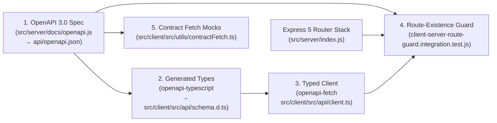

# Design Document 0004: Client↔Server Contract Audit & Seam Guard Architecture

- **Status:** Implemented
- **Context Date:** November 2026

## 1. Overview & Motivation

Wishboard maintains strong unit test coverage and nightly Stryker mutation testing across its frontend (`src/client/src/`) and backend (`src/server/`). However, when frontend unit tests stub `globalThis.fetch` with hand-written mock URLs and JSON payloads while backend integration tests invoke Express routes via Supertest, a **contract seam** can open between the two halves:

1. **Historical Seam Bug #1 (`POST /api/admin/users/{username}/reset-password`):**
   - `UserAccountsSection.tsx` originally passed `account.id` (an opaque UUID) to `/api/admin/users/${id}/reset-password` and read `data.newPassphrase` (camelCase).
   - Meanwhile, `src/server/routes/admin.js` looked up `WHERE username = ?` and returned `{ success: true, new_passphrase }` (snake_case).
   - Unit tests on the client mocked `fetch` to accept the UUID and return `{ newPassphrase }`, while server tests passed `username` and asserted `{ new_passphrase }`. Both suites were 100% green while the live button 404'd.
2. **Uncovered Seam Bug #2 (`POST /api/users/me/exclusions` vs `POST /api/wishes/exclusions/import`):**
   - During the comprehensive client↔server contract audit conducted for this design document, we discovered that `migrateLocalStorageExclusions` in `src/client/src/AuthContext.tsx` called `POST /api/users/me/exclusions` with `{ wish_id }`.
   - That endpoint **did not exist** on the Express server (returning 404 in production), yet `AuthContext.test.tsx` explicitly mocked `url === '/api/users/me/exclusions'` and reported green!
   - Furthermore, `ExclusionImportInputSchema` in `src/server/docs/openapi.js` documented `{ exclusions: string[] }` for `POST /api/wishes/exclusions/import`, whereas `src/server/routes/wishes.js` actually read `const { ids } = req.body`.

This document records the complete Client↔Server↔OpenAPI contract audit matrix and specifies the four-layer defense that permanently caulks this seam.

---

## 2. Defense-in-Depth Architecture

1. **Automated Route-Existence & OpenAPI Guard (`tests/integration/client-server-route-guard.integration.test.js`):**
   - Statically extracts every `fetch('/api/...')` and `apiClient.<METHOD>('/api/...')` call from `src/client/src/**/*.{ts,tsx}` and verifies that every concrete path + HTTP method resolves to both a mounted Express 5 route handler (excluding the `*path` SPA fallback) and a documented operation in `getOpenApiDocument().paths`.
2. **Compile-Time Contract-Typed Client (`src/client/src/api/client.ts` + `src/client/src/api/schema.d.ts`):**
   - `npm run api:types` runs `openapi-typescript` against `api/openapi.json` to emit `src/client/src/api/schema.d.ts`.
   - `apiClient` wraps `openapi-fetch` (`createClient<paths>()`) so path templates, path/query parameters, request bodies, and response properties are checked by `tsc` at build time.
3. **Contract-Validated Test Mocks (`src/client/src/utils/contractFetch.ts`):**
   - `createContractFetchMock` validates every unit-test request URL, HTTP method, JSON request body, and mock response payload against `api/openapi.json`, throwing a descriptive `[ContractViolation]` error if a test mocks an undocumented endpoint or an invalid response shape.
4. **Unmocked E2E Verification (`tests/e2e/admin-panel.spec.ts`):**
   - Exercises admin user promotion/demotion, passphrase reset (asserting the rendered 3-word passphrase), and user deletion against the live SQLite backend in Playwright.

---

## 3. Complete Client ↔ Server ↔ OpenAPI Audit Matrix

All 52 client API call sites across 22 files in `src/client/src/` were audited against `src/server/routes/*` and `api/openapi.json`:

| #   | Client File                                                                                           | Method                    | Client Endpoint / Template                                                                  | Express Route (`src/server/routes/*`)            | OpenAPI Path (`api/openapi.json`)                      | Status                                     |
| :-- | :---------------------------------------------------------------------------------------------------- | :------------------------ | :------------------------------------------------------------------------------------------ | :----------------------------------------------- | :----------------------------------------------------- | :----------------------------------------- |
| 1   | `AccountPage.tsx`                                                                                     | `GET`                     | `/api/users/exists`                                                                         | `GET /api/users/exists`                          | `/api/users/exists`                                    | Migrated to `apiClient`                    |
| 2   | `AccountPage.tsx`                                                                                     | `POST`                    | `/api/wishes/{id}/claim`                                                                    | `POST /api/wishes/:id/claim`                     | `/api/wishes/{id}/claim`                               | Migrated to `apiClient`                    |
| 3   | `AccountPage.tsx`                                                                                     | `GET`                     | `/api/wishes`                                                                               | `GET /api/wishes`                                | `/api/wishes`                                          | Migrated to `apiClient`                    |
| 4   | `AccountPage.tsx`                                                                                     | `PUT`                     | `/api/users/me/passphrase`                                                                  | `PUT /api/users/me/passphrase`                   | `/api/users/me/passphrase`                             | Migrated to `apiClient`                    |
| 5   | `AccountPage.tsx`                                                                                     | `GET`                     | `/api/users/me/wishes`                                                                      | `GET /api/users/me/wishes`                       | `/api/users/me/wishes`                                 | Migrated to `apiClient`                    |
| 6   | `AccountPage.tsx`                                                                                     | `GET`                     | `/api/wishes/exclusions`                                                                    | `GET /api/wishes/exclusions`                     | `/api/wishes/exclusions`                               | Migrated to `apiClient`                    |
| 7   | `AccountPage.tsx`                                                                                     | `PUT`                     | `/api/users/me`                                                                             | `PUT /api/users/me`                              | `/api/users/me`                                        | Migrated to `apiClient`                    |
| 8   | `AccountPage.tsx`                                                                                     | `POST`                    | `/api/wishes/{id}/manage`                                                                   | `POST /api/wishes/:id/manage`                    | `/api/wishes/{id}/manage`                              | Migrated to `apiClient`                    |
| 9   | `AccountPage.tsx`                                                                                     | `DELETE`                  | `/api/wishes/{id}/exclude`                                                                  | `DELETE /api/wishes/:id/exclude`                 | `/api/wishes/{id}/exclude`                             | Migrated to `apiClient`                    |
| 10  | `AccountPage.tsx`                                                                                     | `GET`                     | `/api/users/me/delete-preview`                                                              | `GET /api/users/me/delete-preview`               | `/api/users/me/delete-preview`                         | Migrated to `apiClient`                    |
| 11  | `AccountPage.tsx`                                                                                     | `POST`                    | `/api/users/me/delete`                                                                      | `POST /api/users/me/delete`                      | `/api/users/me/delete`                                 | Migrated to `apiClient`                    |
| 12  | `AccountPage.tsx`                                                                                     | `POST`                    | `/api/users/me/deactivate` & `/reactivate`                                                  | `POST /api/users/me/deactivate` & `/reactivate`  | `/api/users/me/deactivate` & `/reactivate`             | Migrated to `apiClient`                    |
| 13  | `AuthContext.tsx`                                                                                     | `PUT`                     | `/api/users/me`                                                                             | `PUT /api/users/me`                              | `/api/users/me`                                        | Verified                                   |
| 14  | `AuthContext.tsx`                                                                                     | `POST`                    | `/api/wishes/exclusions/import`                                                             | `POST /api/wishes/exclusions/import`             | `/api/wishes/exclusions/import`                        | **Fixed** (was `/api/users/me/exclusions`) |
| 15  | `AuthContext.tsx`                                                                                     | `GET`                     | `/api/users/me`                                                                             | `GET /api/users/me`                              | `/api/users/me`                                        | Verified                                   |
| 16  | `AuthContext.tsx`                                                                                     | `POST`                    | `/api/users/login`                                                                          | `POST /api/users/login`                          | `/api/users/login`                                     | Verified                                   |
| 17  | `AuthContext.tsx`                                                                                     | `POST`                    | `/api/users/register`                                                                       | `POST /api/users/register`                       | `/api/users/register`                                  | Verified                                   |
| 18  | `AuthContext.tsx`                                                                                     | `POST`                    | `/api/users/logout`                                                                         | `POST /api/users/logout`                         | `/api/users/logout`                                    | Verified                                   |
| 19  | `BrandingStudioSection.tsx`                                                                           | `GET`                     | `/api/admin/branding`                                                                       | `GET /api/admin/branding`                        | `/api/admin/branding`                                  | Migrated to `apiClient`                    |
| 20  | `BrandingStudioSection.tsx`                                                                           | `POST`                    | `/api/admin/branding/upload`                                                                | `POST /api/admin/branding/upload`                | `/api/admin/branding/upload`                           | Migrated to `apiClient`                    |
| 21  | `BrandingStudioSection.tsx`                                                                           | `PUT`                     | `/api/admin/branding`                                                                       | `PUT /api/admin/branding`                        | `/api/admin/branding`                                  | Migrated to `apiClient`                    |
| 22  | `BrandingStudioSection.tsx`                                                                           | `DELETE`                  | `/api/admin/branding`                                                                       | `DELETE /api/admin/branding`                     | `/api/admin/branding`                                  | Migrated to `apiClient`                    |
| 23  | `DemoSeederSection.tsx`                                                                               | `POST`                    | `/api/admin/reset-demo`                                                                     | `POST /api/admin/reset-demo`                     | `/api/admin/reset-demo`                                | Migrated to `apiClient`                    |
| 24  | `FlaggedWishesSection.tsx`                                                                            | `GET`                     | `/api/admin/flags`                                                                          | `GET /api/admin/flags`                           | `/api/admin/flags`                                     | Migrated to `apiClient`                    |
| 25  | `FlaggedWishesSection.tsx`                                                                            | `POST`                    | `/api/admin/wishes/{id}/remove`                                                             | `POST /api/admin/wishes/:id/remove`              | `/api/admin/wishes/{id}/remove`                        | Migrated to `apiClient`                    |
| 26  | `FlaggedWishesSection.tsx`                                                                            | `POST`                    | `/api/admin/wishes/{id}/clear-flag`                                                         | `POST /api/admin/wishes/:id/clear-flag`          | `/api/admin/wishes/{id}/clear-flag`                    | Migrated to `apiClient`                    |
| 27  | `FlaggedWishesSection.tsx`                                                                            | `POST`                    | `/api/admin/wishes/clear-all-flags`                                                         | `POST /api/admin/wishes/clear-all-flags`         | `/api/admin/wishes/clear-all-flags`                    | Migrated to `apiClient`                    |
| 28  | `MatchingRulesSection.tsx`                                                                            | `GET`                     | `/api/rules`                                                                                | `GET /api/rules`                                 | `/api/rules`                                           | Migrated to `apiClient`                    |
| 29  | `MatchingRulesSection.tsx`                                                                            | `DELETE`                  | `/api/rules/{id}`                                                                           | `DELETE /api/rules/:id`                          | `/api/rules/{id}`                                      | Migrated to `apiClient`                    |
| 30  | `MatchingRulesSection.tsx`                                                                            | `POST` / `PUT`            | `/api/rules` & `/api/rules/{id}`                                                            | `POST /api/rules` & `PUT /api/rules/:id`         | `/api/rules` & `/api/rules/{id}`                       | Migrated to `apiClient`                    |
| 31  | `SystemLogsSection.tsx`                                                                               | `GET`                     | `/api/admin/logs`                                                                           | `GET /api/admin/logs`                            | `/api/admin/logs`                                      | Migrated to `apiClient`                    |
| 32  | `SystemOverviewSection.tsx`                                                                           | `GET`                     | `/api/config`                                                                               | `GET /api/config`                                | `/api/config`                                          | Migrated to `apiClient`                    |
| 33  | `UserAccountsSection.tsx`                                                                             | `GET`                     | `/api/admin/users`                                                                          | `GET /api/admin/users`                           | `/api/admin/users`                                     | Migrated to `apiClient`                    |
| 34  | `UserAccountsSection.tsx`                                                                             | `GET`                     | `/api/admin/config`                                                                         | `GET /api/admin/config`                          | `/api/admin/config`                                    | Migrated to `apiClient`                    |
| 35  | `UserAccountsSection.tsx`                                                                             | `POST`                    | `/api/admin/users/{id}/role`                                                                | `POST /api/admin/users/:id/role`                 | `/api/admin/users/{id}/role`                           | Migrated to `apiClient`                    |
| 36  | `UserAccountsSection.tsx`                                                                             | `POST`                    | `/api/admin/users/{username}/reset-password`                                                | `POST /api/admin/users/:username/reset-password` | `/api/admin/users/{username}/reset-password`           | Migrated to `apiClient`                    |
| 37  | `UserAccountsSection.tsx`                                                                             | `GET`                     | `/api/admin/users/{id}/delete-preview`                                                      | `GET /api/admin/users/:id/delete-preview`        | `/api/admin/users/{id}/delete-preview`                 | Migrated to `apiClient`                    |
| 38  | `UserAccountsSection.tsx`                                                                             | `POST`                    | `/api/admin/users/{id}/delete`                                                              | `POST /api/admin/users/:id/delete`               | `/api/admin/users/{id}/delete`                         | Migrated to `apiClient`                    |
| 39  | `AwsMetricsDashboard.tsx` / `LocalMetricsDashboard.tsx`                                               | `GET`                     | `/api/admin/aws-metrics` & `/api/admin/local-metrics`                                       | `GET /api/admin/aws-metrics` & `/local-metrics`  | `/api/admin/aws-metrics` & `/local-metrics`            | Verified                                   |
| 40  | `FlagButton.tsx`                                                                                      | `POST`                    | `/api/wishes/${id}/flag`                                                                    | `POST /api/wishes/:id/flag`                      | `/api/wishes/{id}/flag`                                | Verified                                   |
| 41  | `SendWishmailModal.tsx`                                                                               | `POST`                    | `/api/wishes/${id}/mail`                                                                    | `POST /api/wishes/:id/mail`                      | `/api/wishes/{id}/mail`                                | Verified                                   |
| 42  | `WiFiQrCode.tsx` / `DisplayPage.tsx` / `EventProfileContext.tsx` / `PosterPage.tsx` / `AboutPage.tsx` | `GET`                     | `/api/config`                                                                               | `GET /api/config`                                | `/api/config`                                          | Verified                                   |
| 43  | `useExcludedWishes.ts`                                                                                | `GET` / `POST` / `DELETE` | `/api/wishes/exclusions/list`, `/api/wishes/exclusions/import`, `/api/wishes/${id}/exclude` | `src/server/routes/wishes.js`                    | `/api/wishes/exclusions/*`, `/api/wishes/{id}/exclude` | Verified                                   |
| 44  | `DisplayPage.tsx`                                                                                     | `GET`                     | `/api/wishes/random`                                                                        | `GET /api/wishes/random`                         | `/api/wishes/random`                                   | Verified                                   |
| 45  | `EnterWishPage.tsx`                                                                                   | `POST`                    | `/api/wishes`                                                                               | `POST /api/wishes`                               | `/api/wishes`                                          | Verified                                   |
| 46  | `ManageWishPage.tsx`                                                                                  | `GET` / `POST`            | `/api/wishes/${id}`, `/manage`, `/deactivate`, `/reactivate`                                | `src/server/routes/wishes.js`                    | `/api/wishes/{id}/*`                                   | Verified                                   |
| 47  | `SearchPage.tsx`                                                                                      | `GET`                     | `/api/wishes`                                                                               | `GET /api/wishes`                                | `/api/wishes`                                          | Verified                                   |
| 48  | `WishmailDashboard.tsx`                                                                               | `POST` / `DELETE`         | `/api/wishes/${id}/mail`, `/mail/${mailId}/read`, `/mail/${mailId}`                         | `src/server/routes/wishes.js`                    | `/api/wishes/{id}/mail*`                               | Verified                                   |
| 49  | `conflicts.ts`                                                                                        | `POST`                    | `/api/rules/check-conflicts`                                                                | `POST /api/rules/check-conflicts`                | `/api/rules/check-conflicts`                           | Verified                                   |
